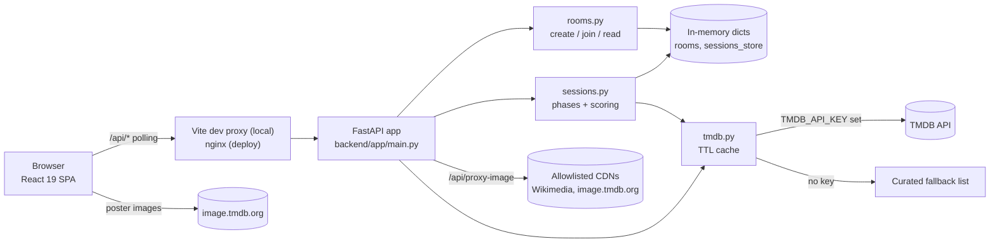

# Movie Helper

**Pick a movie together, without the 40-minute debate.** Friends join a room, choose genres, vote on a short deck of movies, and the app narrows the votes down to one winner.

[](https://github.com/LuisEduardoGE/movie-helper/actions/workflows/ci.yml)
[](LICENSE)


## Table of Contents

- [Features](#features)
- [Tech Stack](#tech-stack)
- [Architecture](#architecture)
- [Quick Start](#quick-start)
- [Configuration](#configuration)
- [Usage: how a session works](#usage-how-a-session-works)
- [API](#api)
- [Testing](#testing)
- [Project Structure](#project-structure)
- [Deploy](#deploy)
- [Credits](#credits)

## Features

- Rooms with a 5-character code or a QR invite; players join with a name and a character avatar.
- Genre picking per player; the deck waits until everyone has locked in.
- A shared deck of 12 movies from TMDB, drawn from a pool of 80 candidates and reordered by the group's affinity as votes come in.
- Four votes per card: *like*, *maybe*, *dislike* or *seen*.
- Elimination rounds after discovery: pairwise maybes, a harder narrow round, then head to head.
- Phase-weighted scoring with a unanimity bonus and TMDB-rating tiebreak.
- **Choose again** deals a fresh deck that skips every movie already shown.
- Runs without a TMDB key on a curated fallback list.

## Tech Stack

| Layer | Choice |
|---|---|
| Back end | FastAPI 0.115 + Pydantic v2, `httpx` for TMDB with an in-process cache; rooms and sessions in memory (no database) |
| Front end | React 19 + Vite 6 + TypeScript, hand-written components and CSS design tokens |
| Sync | Clients poll the session (1.5 s while voting, 2.5 s otherwise); a single server-side cursor keeps every player on the same card |
| Safety | Image proxy restricted to an allowlist of public CDNs (SSRF guard); TLS verified by default |
| Tooling | pytest + FastAPI `TestClient`, Ruff, `tsc --noEmit`, GitHub Actions |

## Architecture



The React app talks only to `/api/*`; in development Vite proxies it to the backend on port 8000, and on the server nginx serves `frontend/dist` and proxies `/api/`. The backend keeps rooms and sessions in module-level dictionaries, so a restart clears them. All TMDB access goes through `tmdb.py`, which caches responses and falls back to a curated list when no key is set.

## Quick Start

Prerequisites: Python 3.12, Node.js 22+, `make` (optional).

```bash
make install        # backend deps (incl. pytest, ruff) + frontend deps
make run            # backend :8000, frontend http://127.0.0.1:5173
```

Without make:

```bash
# one-time setup
cd backend && python -m venv .venv
source .venv/bin/activate          # Windows: .venv\Scripts\activate
pip install -r requirements.txt
cd ../frontend && npm install && cd ..

# every time, from the repo root
cp .env.example .env               # optional: add a free TMDB key for real posters
python run.py                      # backend :8000, frontend http://127.0.0.1:5173
```

`run.py` uses `backend/.venv` when it exists and installs the frontend packages if they are missing. Without a TMDB key the app runs on a curated fallback list.

## Configuration

| Variable | Default | Purpose |
|---|---|---|
| `TMDB_API_KEY` | empty | Free key from [TMDB](https://www.themoviedb.org/settings/api). Read from the environment or a `.env` file (repo root, `backend/`, or the working directory). Without it the curated fallback runs. |
| `MOVIE_HELPER_INSECURE_TLS` | unset | Set to `1` to skip TLS verification for public-CDN requests, only for machines behind a TLS-intercepting proxy. Read from the real environment, not from `.env`. |
| `DEPLOY_SSH_HOST` | none | SSH host for `deploy.py` (environment or `.env.deploy`). |
| `DEPLOY_PUBLIC_HOST` | none | Public host or IP for the nginx `server_name` and the printed app URL in `deploy.py`. |

## Usage: how a session works

1. **Room**: one person starts a room and shares its 5-character code (or a QR invite); friends join with a name and a character avatar.
2. **Genres**: each player picks and locks the genres they are in the mood for; the deck waits until everyone has locked in.
3. **Discovery**: everyone votes on the same deck of 12 movies from TMDB: *like*, *maybe*, *dislike* or *seen*. The deck is drawn from a pool of 80 candidates and reordered by the group's affinity as votes come in, so the best matches surface early.
4. **Settle the maybes**: movies marked *maybe* are compared in pairs, each player choosing the one they prefer.
5. **Narrow**: the surviving movies go through a harder round.
6. **Head to head**: the strongest candidates face off until one is left.
7. **Reveal**: the winner is shown with its poster and details. Not happy? **Choose again** deals a fresh deck that skips every movie already shown.

Scoring is phase-weighted: a *like* in a later, harder round counts more than one in discovery, a *maybe* earns partial credit, a movie everyone liked gets a unanimity bonus, and ties go to the higher TMDB rating. Movies anyone marked *seen* are left out of the ranking.

## API

| Endpoint | Purpose |
|---|---|
| `GET /api/health` | Health check (reports whether a TMDB key is set) |
| `GET /api/genres` · `/api/trending` · `/api/movies/{id}` | TMDB data |
| `GET /api/avatar-options` | Character avatars for the join screen |
| `GET /api/proxy-image?url=…` | Image proxy for allowlisted CDNs (400 for any other host) |
| `POST /api/rooms` · `POST /api/rooms/{code}/join` · `GET /api/rooms/{code}` | Create, join and read a room |
| `POST /api/rooms/{code}/session` · `DELETE /api/rooms/{code}/session` | Start or abandon a session |
| `POST /api/rooms/{code}/session/genres` · `/vote` · `/pairwise` · `/h2h` | Each voting phase |
| `POST /api/rooms/{code}/session/winner` · `/redraw` · `GET .../session/top` | Result, redraw and current ranking |

## Testing

```bash
make test           # backend pytest suite
make lint           # ruff + tsc --noEmit
make build          # production build of the frontend
```

12 backend tests pass. They cover the API through FastAPI's `TestClient` (health check, the image proxy rejecting non-allowlisted hosts and plain HTTP, creating, joining and reading rooms, validation and 404s) and the pure scoring functions (discovery weights, unanimity bonus, later-phase weights, ranking with the rating tiebreak, and exclusion of *seen* movies). No TMDB key or network access is needed.

## Project Structure

```
backend/
  app/main.py        FastAPI app: health, TMDB endpoints, image proxy
  app/rooms.py       Rooms and players (in memory)
  app/sessions.py    Session phases, voting and phase-weighted scoring
  app/tmdb.py        TMDB client, TTL cache and curated fallback
  tests/             pytest suite
frontend/
  src/components/    Screens and cards (welcome, lobby, swipe deck, head to head, reveal)
  src/lib/           API client, TMDB image URLs, helpers
docs/                Screenshot, design notes and project context
run.py               Starts backend and frontend together
deploy.py            Builds and deploys to a Linux VPS over SSH
Makefile             install / run / test / lint / build / clean
```

## Deploy

`python deploy.py` builds the front end and deploys both halves to a Linux VPS over SSH (systemd + nginx). Set `DEPLOY_SSH_HOST` and `DEPLOY_PUBLIC_HOST` in the environment or in a git-ignored `.env.deploy` (see `.env.deploy.example`).

## Credits

Movie data and images from [TMDB](https://www.themoviedb.org/). This product uses the TMDB API but is not endorsed or certified by TMDB.

## Author

**Luis Eduardo G. Espindola** · [GitHub](https://github.com/LuisEduardoGE) · [LinkedIn](https://www.linkedin.com/in/luisgespindola/)

## License

[MIT](LICENSE) © Luis Eduardo G. Espindola
